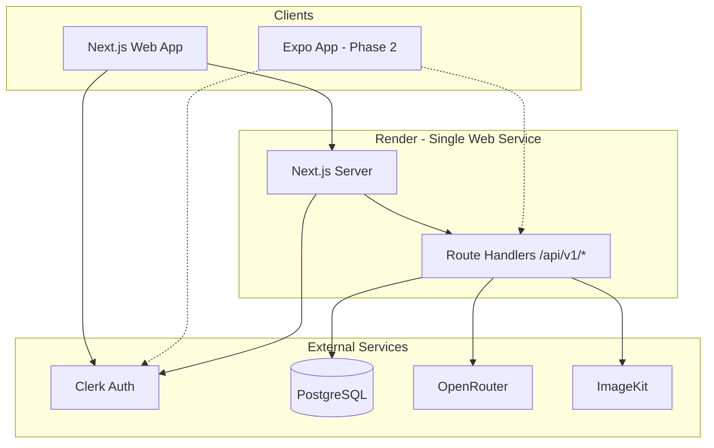
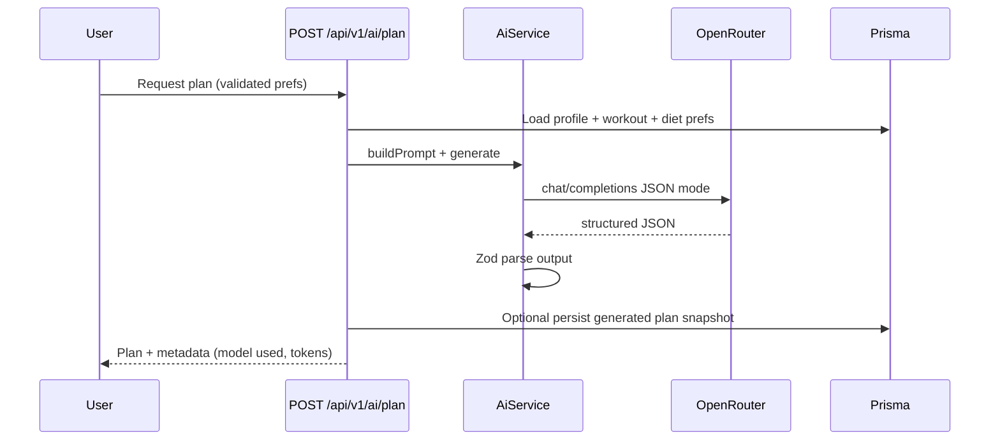

# PeakFit V2 — Architecture

**Last updated:** 2026-11-26

---

## 1. System context

PeakFit V2 is an **individual fitness platform**: profiles, workout/diet preferences, AI-assisted plans, and **comprehensive progress tracking**. One user, one data boundary — no trainers or multi-tenant coach features.



---

## 2. Layered design (within `web/`)

```
app/                    # Routes, layouts, pages (RSC where sensible)
  (marketing)/          # Public landing
  (app)/                # Authenticated app shell
  api/v1/               # Versioned HTTP API
components/
  ui/                   # shadcn primitives
  features/             # Domain components (workout, progress, etc.)
lib/
  db.ts                 # Prisma singleton
  auth.ts               # Clerk helpers (currentUser, userId)
  validators/           # Zod schemas shared by API + forms
  services/             # Business logic (no HTTP in services)
    profile.service.ts
    workout.service.ts
    diet.service.ts
    ai.service.ts
    progress/
    goals.service.ts
    media.service.ts
  api/                  # Response helpers, error types
prisma/
  schema.prisma
  migrations/
```

**Rules:**

- Route handlers: parse auth → validate (Zod) → call service → map response.
- Services: Prisma transactions for multi-table writes.
- No Prisma calls inside React client components.

---

## 3. Authentication and authorization

**Clerk** is the source of truth for identity.

- **Web:** `@clerk/nextjs` middleware protects `(app)` routes.
- **API:** Every `/api/v1/*` handler resolves `userId` via Clerk `auth()`; reject `401` if missing.
- **Data isolation:** All Prisma queries include `where: { clerkUserId: userId }` (or internal `userId` mapped 1:1 from Clerk).

**Application user record:**

```text
User (Prisma)
  clerkUserId  String @unique
  email        String?  // synced from Clerk webhook
  createdAt, updatedAt
  profile, preferences, progress relations...
```

**Account deletion:**

1. Clerk user deleted (app settings or Clerk dashboard flow).
2. Webhook or API orchestration deletes cascaded Prisma data.
3. ImageKit assets removed or orphaned per policy (document in migration).

**Legacy migration:** Map `peakfit_users.id` → new `User.id` with `legacyUserId` column **temporary** for migration audit; store `clerkUserId` after Clerk import.

---

## 4. AI generation (OpenRouter)



**Principles:**

- Model IDs from env only (`OPENROUTER_MODEL`, optional fallback).
- Zod schema for AI output; retry once on parse failure with fallback model if configured.
- Rate limit per user (e.g. sliding window in DB or Upstash later — v1 can use simple DB counter).
- Never return hardcoded exercises/meals as “generated” without API call.

---

## 5. Media (ImageKit)

- Upload via server buffer upload (`src/lib/integrations/imagekit/client.ts`) or **client direct upload** using `getAuthenticationParameters()`.
- Progress photos: tagged by `userId` folder/prefix; metadata row in `ProgressPhoto` (Prisma field `cloudinaryPublicId` temporarily stores ImageKit `fileId` until a rename migration).
- Use Next.js `Image` with ImageKit CDN URLs where applicable.

---

## 6. Progress tracking domain

Normalized **append-only history** for metrics (weight, body fat, measurements, steps, water, sleep, calories). Workout **sessions** contain **exercise logs** and **sets**. **PersonalRecord** derived or updated on write via service layer (explicit rules in `DATABASE_DOCUMENTATION.md`).

**Time:**

- Store instants in **UTC** (`timestamptz`).
- User preference `timezone` (IANA string) on profile for “daily” aggregates.
- Daily rollups computed in queries or materialized views later if needed (v1: query with date bounds in user TZ).

---

## 7. API versioning and mobile readiness

- Prefix: `/api/v1/...`
- JSON: `{ data, error?, meta? }` convention.
- Pagination: `cursor` or `page/limit` for history lists.
- Same endpoints for web and future Expo client (Bearer via Clerk session token pattern for mobile).

---

## 8. Deployment (Render)

- **One** Web Service: build `web/` (`npm ci && npx prisma migrate deploy && npm run build`).
- **PostgreSQL:** Render Postgres or external (connection string in `DATABASE_URL`).
- **Health:** `GET /api/v1/health` → DB ping.
- **Logs:** stdout structured JSON in production helpers.

No separate worker unless AI queueing is approved later.

---

## 9. Security summary

| Control | Implementation |
|---------|----------------|
| Auth | Clerk |
| Authorization | Server-side `userId` on every mutation |
| Validation | Zod on all inputs |
| Secrets | Env only |
| AI abuse | Rate limits + auth |
| Upload abuse | Auth + size/type checks |
| Errors | Sanitized client messages |

---

## 10. Architectural decisions log

| Decision | Choice | Why |
|----------|--------|-----|
| Monolith Next.js | Yes | Single deploy on Render; shared types; mobile uses same API |
| Clerk | Yes | User-approved; strong web + mobile path |
| Prisma | Yes | Migrations, relations for large progress schema |
| `web/` folder | Yes | Preserves legacy for migration reference |
| No trainers | Yes | Product scope |
| OpenRouter | Yes | Flexible models; keys server-side |
| API version prefix | `/api/v1` | Safe evolution for Phase 2 |