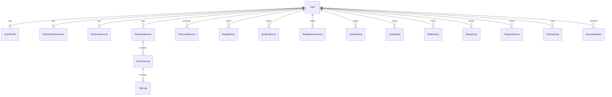

# PeakFit V2 — Database Documentation

**ORM:** Prisma  
**Database:** PostgreSQL  
**Last updated:** 2026-11-26

---

## 1. Design principles

- **User isolation:** Every row tied to `User.id` via `clerkUserId` resolution.
- **Historical integrity:** Metric tables are **append-only** by default; updates/deletes only via explicit user actions on individual records.
- **No trainer data** in V2 schema.
- **Indexes** on `(userId, recordedAt)` or `(userId, date)` for chart queries.
- **Cascades:** `onDelete: Cascade` from `User` to owned child records.
- **Transactions** for session + sets + PR updates.

---

## 2. Entity relationship overview

---

## 3. Core models (Prisma-level specification)

### 3.1 `User`

| Field | Type | Notes |
|-------|------|-------|
| `id` | `String` cuid/uuid | Internal PK |
| `clerkUserId` | `String` @unique | Clerk `userId` |
| `legacyUserId` | `Int?` @unique | Migration only; nullable after cutover |
| `email` | `String?` | Synced from Clerk |
| `timezone` | `String` default `UTC` | IANA, e.g. `Asia/Kolkata` |
| `unitSystem` | `Enum` METRIC/IMPERIAL | Display + validation |
| `createdAt` | DateTime | |
| `updatedAt` | DateTime | |

### 3.2 `UserProfile`

One-to-one with `User`.

| Field | Type | Notes |
|-------|------|-------|
| `fullName` | String? | |
| `age` | Int? | |
| `gender` | Enum? | MALE, FEMALE, OTHER, UNSPECIFIED |
| `heightCm` | Decimal? | Canonical metric storage |
| `weightKg` | Decimal? | **Current** snapshot; history in `WeightEntry` |
| `goal` | Enum? | BULK, CUT, MAINTAIN, etc. |
| `profileImageUrl` | String? | ImageKit CDN URL |
| `bio` | String? | Optional |

### 3.3 `WorkoutPreferences`

One-to-one; maps legacy `peakfit_workout_plans` (latest row per user on migration).

| Field | Type | Notes |
|-------|------|-------|
| `workoutDays` | Json | String[] weekday names |
| `restDays` | Json | String[] |
| `intensity` | Enum | LIGHT, MODERATE, INTENSE |
| `durationMinutes` | Int | |
| `workoutType` | String | e.g. Strength, HIIT |
| `muscleGroups` | Json | String[] |
| `exercises` | Json | String[] preferred exercises |
| `calorieBurnGoal` | Int? | |
| `equipment` | Json | String[] |
| `remindersEnabled` | Boolean | |
| `progressiveOverload` | Boolean | |
| `warmUpCoolDown` | Boolean | |
| ~~trainerAccess~~ | — | **Not in V2** |

### 3.4 `DietPreferences`

One-to-one; maps legacy `peakfit_diet_plans`.

| Field | Type | Notes |
|-------|------|-------|
| `dietType` | String | Vegan, Keto, etc. |
| `carbPreference` | String | |
| `allergies` | String? | |
| `mealFrequency` | String | |
| `cheatMealsPerWeek` | Int? | |
| `calorieTarget` | Int? | Daily target (V2 addition) |

---

## 4. Workout logging

### 4.1 `WorkoutSession`

| Field | Type | Notes |
|-------|------|-------|
| `id` | String | |
| `userId` | FK | |
| `startedAt` | DateTime | |
| `endedAt` | DateTime? | |
| `notes` | String? | |
| `source` | Enum | MANUAL, AI_PLAN, IMPORTED |

### 4.2 `ExerciseLog`

| Field | Type | Notes |
|-------|------|-------|
| `sessionId` | FK | |
| `exerciseName` | String | |
| `orderIndex` | Int | |

### 4.3 `SetLog`

| Field | Type | Notes |
|-------|------|-------|
| `exerciseLogId` | FK | |
| `setNumber` | Int | |
| `reps` | Int? | |
| `weightKg` | Decimal? | Canonical |
| `durationSec` | Int? | For timed exercises |
| `rpe` | Decimal? | Optional |

**Indexes:** `(userId, startedAt)` on session via join; `(exerciseLogId, setNumber)`.

---

## 5. Personal records

### `PersonalRecord`

| Field | Type | Notes |
|-------|------|-------|
| `userId` | FK | |
| `exerciseName` | String | |
| `recordType` | Enum | MAX_WEIGHT, MAX_REPS, EST_1RM, etc. |
| `value` | Decimal | |
| `unit` | String | kg, reps |
| `achievedAt` | DateTime | |
| `setLogId` | String? | Provenance |

**Uniqueness:** `@@unique([userId, exerciseName, recordType])` — update row when PR beaten (preserve `achievedAt` history optionally via `PersonalRecordHistory` table if audit required; v1 can update in place with `previousValue` log table optional).

*Decision for implementation:* Prefer **`PersonalRecordHistory`** append table when PR changes to satisfy “historical records” for PRs.

---

## 6. Body composition & measurements

### `WeightEntry`

| Field | Type |
|-------|------|
| `userId`, `recordedAt`, `weightKg`, `note?` |

### `BodyFatEntry`

| Field | Type |
|-------|------|
| `userId`, `recordedAt`, `bodyFatPercent`, `note?` |

### `BodyMeasurement`

| Field | Type |
|-------|------|
| `userId`, `recordedAt`, `chestCm`, `waistCm`, `armCm`, `thighCm`, `note?` |

All support **update/delete by id** without affecting other rows.

---

## 7. Nutrition & activity

### `CalorieEntry`

| Field | Type | Notes |
|-------|------|-------|
| `userId` | FK | |
| `recordedAt` | DateTime | |
| `type` | Enum | INTAKE, EXPENDITURE |
| `calories` | Int | Positive |
| `description` | String? | |

### `ActivityDay` (steps)

| Field | Type | Notes |
|-------|------|-------|
| `userId` | FK | |
| `date` | Date | User-local date (store + `timezone` used at write) |
| `steps` | Int | |
| @@unique([userId, date]) | | One row per day; update allowed |

### `WaterEntry`

| Field | Type | Notes |
|-------|------|-------|
| `userId`, `recordedAt`, `amountMl` | | |

### `SleepEntry`

| Field | Type | Notes |
|-------|------|-------|
| `userId`, `recordedAt`, `durationMinutes`, `quality?` | | |

---

## 8. Visual progress

### `ProgressPhoto`

| Field | Type |
|-------|------|
| `userId`, `takenAt`, `imageUrl`, `caption?`, `cloudinaryPublicId?` (ImageKit `fileId` until column rename) |

---

## 9. Goals

### `FitnessGoal`

| Field | Type | Notes |
|-------|------|-------|
| `userId` | FK | |
| `metricType` | Enum | WEIGHT, BODY_FAT, STEPS, CALORIES, CUSTOM |
| `targetValue` | Decimal | |
| `currentValue` | Decimal? | Cached or computed |
| `unit` | String | |
| `deadline` | DateTime? | |
| `status` | Enum | ACTIVE, COMPLETED, ABANDONED |
| `completedAt` | DateTime? | |

Progress computed from latest entries vs target in service layer.

---

## 10. AI artifacts

### `GeneratedPlan`

Optional persistence of AI output.

| Field | Type |
|-------|------|
| `userId`, `generatedAt`, `model`, `planJson` Json, `dayIndex` Int |

---

## 11. Indexes (summary)

| Table | Index |
|-------|-------|
| WeightEntry | `(userId, recordedAt DESC)` |
| BodyFatEntry | `(userId, recordedAt DESC)` |
| WorkoutSession | `(userId, startedAt DESC)` |
| CalorieEntry | `(userId, recordedAt DESC)` |
| ActivityDay | `(userId, date DESC)` |
| FitnessGoal | `(userId, status)` |

---

## 12. Legacy migration mapping

| Legacy table | V2 target | Notes |
|--------------|-----------|-------|
| `peakfit_users` | `User` + **Clerk import** | `legacyUserId`; passwords not stored in V2 |
| `peakfit_profiles` | `UserProfile` | Map column names |
| `peakfit_workout_plans` | `WorkoutPreferences` | Take **latest** `created_at` per user; drop `trainer_access` |
| `peakfit_diet_plans` | `DietPreferences` | One row per user |
| — | Progress tables | Empty for migrated users |

**Migration script requirements (Milestone 2/3):**

1. Read-only connection to `LEGACY_DATABASE_URL`.
2. Export JSON + SQL audit log.
3. Create Clerk users (bulk import API) — **email required**; usernames preserved in profile if needed.
4. Insert Prisma rows in transaction per user.
5. Verification report: counts per table.

**No `DROP DATABASE` or destructive ops** without explicit owner approval.

---

## 13. Prisma migration workflow

1. Author `schema.prisma` in `web/prisma/`.
2. `prisma migrate dev` locally.
3. `prisma migrate deploy` on Render build.
4. Document each migration in git message (user commits).

---

## 14. Open questions (for owner)

- OpenRouter models: env-driven (confirmed pending IDs).
- Whether `PersonalRecordHistory` is mandatory v1 or PR table update suffices (recommend **History** table for audit compliance with spec).