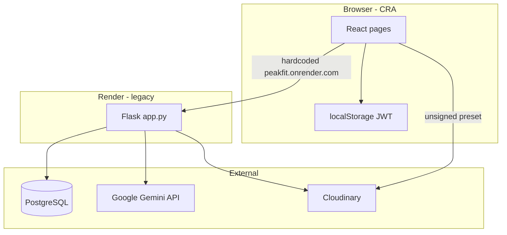

# PeakFit — Project Audit (Milestone 0)

**Audit date:** 2026-11-26  
**Repository:** `peakfit` (local path)  
**Git:** `main` @ `f1f014c` ("connnection error") — in sync with `origin/main`  
**Audit type:** Read-only; no files modified during inspection.

---

## 1. Executive summary

PeakFit is an AI-assisted fitness web app: user accounts, profile, workout/diet **preferences**, and **Day 1** AI-generated workout + meal suggestions. Progress tracking, settings, and several APIs are **incomplete or broken**. The codebase is a **split stack**: Create React App frontend + Flask API + PostgreSQL (configured via env, not defined in repo).

**PeakFit V2** replaces this with a **single Next.js (TypeScript) application** on Render, **Clerk**, **Prisma/PostgreSQL**, **OpenRouter**, and **Cloudinary**, plus full progress tracking. Pre-V2 source remains in **Git history** for migration reference (not in the V2 working tree).

---

## 2. Repository structure (verified)

```
peakfit/                      # V2 branch — see root README.md
├── docs/
├── mobile/
├── prisma/
├── src/
├── tests/
└── scripts/
```

**Audit snapshot (Milestone 0):** Legacy lived at repo-root `frontend/` and `backend/` on commit `f1f014c`. Root `requirements.txt` included an unused Django stack.

**Not present (at audit time):** Docker, Procfile, CI, SQL migrations in repo, deployment manifests.

**Assets (historical):** `frontend/src/assets/` on pre-V2 commits.

---

## 3. Current architecture



| Concern | Implementation |
|--------|----------------|
| Frontend | CRA `react-scripts` 5, React 19, React Router 7, JavaScript, axios/fetch |
| Backend | Flask blueprints, raw SQL via psycopg2 |
| Auth | flask-jwt-extended, Werkzeug password hashes |
| AI | `google.generativeai`, model `text-bison-001` (outdated) |
| Media | Server upload route + client direct upload to Cloudinary |
| Config | `python-dotenv`, env in `config.py` |

Root `requirements.txt` lists **Django 5 + DRF** — not imported by Flask; treat as **dead dependency file**.

---

## 4. Database (inferred from code only)

No migration files exist. Tables referenced:

### `peakfit_users`
- `id`, `username`, `email`, `password_hash`

### `peakfit_profiles`
- `user_id` (FK → users), `full_name`, `height`, `weight`, `age`, `goal`, `gender`, `profile_picture`

### `peakfit_workout_plans`
- `id`, `user_id`, `workout_days`, `rest_days` (JSON), `intensity`, `duration`, `workout_type`, `muscle_groups`, `exercises`, `calorie_burn_goal`, `equipment`, `reminders`, `trainer_access`, `progressive_overload`, `warmup_cooldown`, `created_at`

### `peakfit_diet_plans`
- `id`, `user_id`, `diet_type`, `carb_preference`, `allergies`, `meal_frequency`, `cheat_meals`

**V2 note:** `trainer_access` and related UI exist in legacy only — **excluded from V2** per product scope.

**No tables** for progress metrics, workout logs, goals, measurements, or progress photos.

`backend/models.py` only adds FK constraints if tables already exist.

---

## 5. API inventory (Flask)

| Method | Path | Auth | Purpose |
|--------|------|------|---------|
| POST | `/api/auth/register` | No | Create user |
| POST | `/api/auth/login` | No | JWT access + refresh |
| POST | `/api/auth/refresh` | Refresh JWT | New access token |
| GET | `/api/auth/protected` | JWT | Demo protected route |
| GET | `/api/profile/get-profile` | JWT | Read profile |
| POST | `/api/profile/save-profile` | JWT | Upsert profile (multipart form) |
| GET | `/api/workout/workout_plans` | JWT | Latest workout preferences |
| POST | `/api/workout/workout_plans` | JWT | Insert new plan row |
| POST | `/api/diet/diet-plan` | JWT | Create diet plan (409 if exists) |
| GET | `/api/generate/plan` | JWT | Gemini Day 1 JSON plan |
| POST | `/api/upload/upload` | **None** | Cloudinary upload |
| DELETE | `/api/user/delete_account` | JWT | Delete user row |

**Gaps vs frontend:**
- Diet **GET** and **PUT** missing; `DietPlan.js` calls GET.
- Settings calls `DELETE /delete_account` (wrong path).

---

## 6. Frontend features (by page)

| Page | Route | Functional? | Notes |
|------|-------|-------------|-------|
| Home | `/` | Partial | Marketing; uses AuthContext |
| Auth | `/auth` | Partial | Hits Render; doesn't sync App.js `isLoggedIn` |
| Dashboard | `/dashboard` | Shell | No auth guard |
| ProfileEdit | `/profile` | Partial | Cloudinary hardcoded cloud name |
| WorkoutPlan | `/workout-plan` | Partial | GET response field mismatch |
| DietPlan | `/diet-plan` | Broken read | GET unsupported |
| Today | `/tplan` | Partial | AI + preferences required |
| Progress | `/progress` | **No** | Static cards only |
| Settings | `/settings` | Mostly UI | Delete URL wrong; toggles non-persistent |
| Footer links | `/about`, etc. | **No routes** | 404 in SPA |

**Unused dependencies:** `chart.js`, `react-chartjs-2` (installed, never imported).

---

## 7. Verified bugs and technical debt

| ID | Issue | Severity |
|----|--------|----------|
| B1 | `App.js` `isLoggedIn` vs `AuthContext` — login never sets App state | High |
| B2 | No client route protection | High |
| B3 | Diet GET/PUT missing | High |
| B4 | WorkoutPlan fetch uses `workout_days`; API returns `days` | High |
| B5 | Delete account URL missing `/api/user` prefix | High |
| B6 | All API URLs hardcoded to `peakfit.onrender.com` | Medium |
| B7 | JWT refresh stored, never used | Medium |
| B8 | `generate_plan`: deprecated Gemini model; package not in `backend/requirements.txt` | High |
| B9 | Multiple workout rows per user; generate query no `ORDER BY LIMIT 1` | Medium |
| B10 | `upload` route unauthenticated | High |
| B11 | `Config.SECRET_KEY` fallback default | High |
| B12 | `cloudinary_assets.py` placeholder URLs | Low |
| B13 | CORS open; `debug=True` in `app.py` | Medium |
| B14 | Workout POST sends comma-separated strings; stored via `json.dumps` inconsistently | Medium |
| B15 | Auth errors: UI expects `message`, API returns `error` | Low |

---

## 8. Security review (legacy)

- Passwords hashed with Werkzeug (good).
- No rate limiting, email verification, or password reset flows.
- JWT in `localStorage` (XSS exposure).
- Server upload and AI endpoints lack abuse controls.
- No structured audit logging.

---

## 9. Reuse vs replace (V2)

| Legacy area | V2 disposition |
|-------------|----------------|
| Product concept (profile, prefs, AI day plan) | **Reuse business intent**, reimplement in TypeScript |
| Flask routes | **Replace** with Next.js Route Handlers |
| CRA UI/CSS | **Replace** with Tailwind + shadcn/ui |
| JWT auth | **Replace** with Clerk |
| Gemini integration | **Replace** with OpenRouter (server-only) |
| Table names / JSON preference fields | **Inform** Prisma schema; normalize for progress |
| `trainer_*` fields | **Drop** in V2 |
| Progress page mockup | **Replace** with full tracking system |
| Cloudinary usage pattern | **Evolve** (signed server uploads) |

---

## 10. Migration risks (full legacy data — approved)

1. **Identity:** Legacy users are not in Clerk. Migration requires Clerk user import / migration API or forced password reset; Werkzeug hashes may not transfer directly — document per-user migration or bulk import with email invitation.
2. **Schema mapping:** New Prisma schema is a superset; old preference JSON may need normalization scripts.
3. **No destructive drops** on legacy DB until export verified and V2 validated.
4. **Dual-write period:** None planned; read-only export → transform → load into new DB recommended.

---

## 11. Comparison to approved PeakFit V2 stack

| Layer | Legacy | V2 (approved) |
|-------|--------|-------------|
| Frontend | CRA + JS | Next.js App Router + TS |
| Styling | Per-page CSS | Tailwind + shadcn/ui |
| Backend | Flask | Next.js Route Handlers |
| Validation | Ad hoc | Zod |
| DB access | psycopg2 SQL | Prisma |
| Auth | JWT | Clerk |
| AI | Gemini (broken) | OpenRouter |
| Hosting | Render (Flask) | Render (single Next service) |
| Mobile | — | Expo (Phase 2) |

---

## 12. Audit conclusion

The legacy codebase is **small (~55 source files)** and suitable as a **reference for business rules and field names**, not as a foundation to incrementally patch. V2 should be built in `web/` with a deliberate **export-transform-load migration** from the old PostgreSQL.

**Milestone 0 status:** Complete (re-verified 2026-11-26; no repo changes since prior inspection).